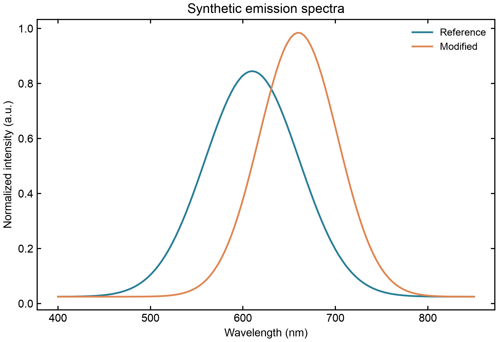

# Scientific Plot Studio · SPS

**在 Mac 上读取 Origin 工程，把科研图保存为可移植、可继续编辑的图件。**

从已有的 Origin 图到汇报或投稿，SPS 把读取、改图和导出串在一起。图页、数据、坐标轴和样式可以一起带走，换电脑或改数据时还能打开工程继续做。

## 四个核心用法

- **在 Mac 上读取 Origin** · 配置对应读取器后，可读取受支持的 `.opj` / `.opju` 文件，提取数据、图页和部分样式，再在 SPS 里编辑。[Origin 读取范围与依赖](docs/ORIGIN_HEADLESS.md)
- **打包可移植图表** · `.spsfig` 把 SPS 工程的数据、样式、图页和图层装进一个文件，传给协作者后可以在 SPS 里重新打开、改图和导出。
- **把工程随 PowerPoint 带走** · 导出的 `.pptx` 同时保存图像和完整 SPS 工程。之后可用 SPS 从演示文稿恢复工程，修改后生成更新版 PPT 副本。
- **把矢量图放进 Illustrator** · 导出 SVG 或 PDF，用于在 Illustrator 中置入和排版。科研数据、坐标轴等仍在 SPS 工程里修改。

## 五分钟跑通示例

需要 Python 3.11 或以上。以下命令适用于 macOS 和 Linux shell，Windows PowerShell 的激活命令是 `.venv\Scripts\Activate.ps1`。

```bash
python3 -m venv .venv
source .venv/bin/activate
python -m pip install -e '.[test]'
python -m sps gui examples/synthetic.sps.json
```

也可以直接用命令行生成示例工程并导出：

```bash
python -m sps demo output/demo.sps.json
python -m sps export output/demo.sps.json output/figures --name demo --formats png svg pdf
```



图中数据由程序生成，仅演示绘图与导出。

## 欢迎测试和改进

欢迎试用，尤其欢迎分享「什么步骤最难用」「哪种图需要反复手调」。遇到问题，可以提交 **Issue**，附上系统、Python 版本、复现步骤和一份合成样例。想改代码或文档，也欢迎提交 **Pull Request**。具体步骤见 [贡献指南](CONTRIBUTING.md)。

## 当前边界

公开版为 Python 源码，Origin 读取器需单独配置。Origin 的复杂对象、完整样式和回写仍有缺口。PowerPoint 的工程编辑在 SPS 中完成，普通复制粘贴可能丢失工程。Illustrator 的 SVG/PDF 导出已验证，应用内往返仍待实测。Windows 与 Linux 桌面体验待验证。

## 许可证

SPS 源码采用 [MIT 许可证](LICENSE)。
